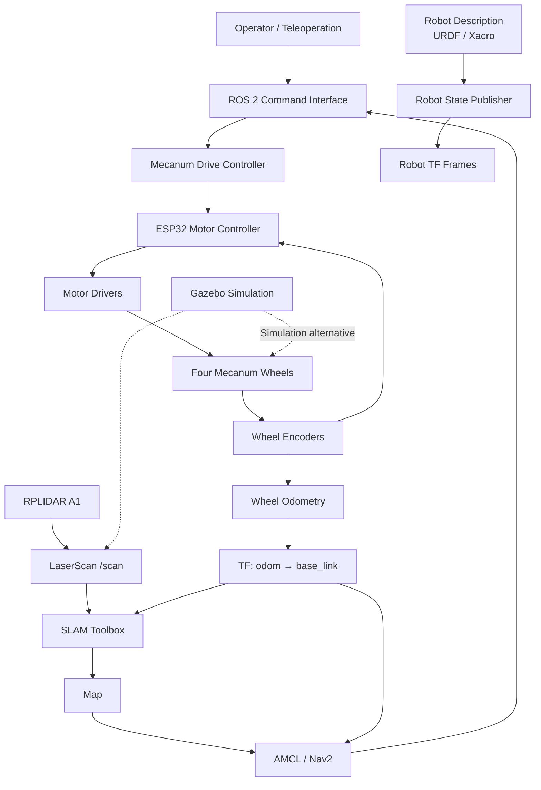

 <div align="center">

# 🤖 GatiBot V2

### Mecanum-Wheel Autonomous Mobile Robot

**A ROS 2-based mobile robotics platform for omnidirectional motion, robot simulation, perception, mapping, and autonomous navigation.**

<p>
  
  
  
  
</p>

<p>
  
  
  
</p>

---

**Designed and developed by Shivam Singh Bais**

</div>

## 📌 Table of Contents

| # | Section | Description |
|---:|---|---|
| 01 | [Overview](#-overview) | Project introduction |
| 02 | [Objectives](#-project-objectives) | Engineering goals |
| 03 | [Features](#-key-features) | Robot capabilities |
| 04 | [Hardware](#-hardware-specifications) | Components and specifications |
| 05 | [Software](#-software-stack) | Development environment |
| 06 | [Architecture](#-system-architecture) | ROS 2 system data flow |
| 07 | [Repository](#-repository-structure) | Package and file organization |
| 08 | [Installation](#-installation-and-setup) | Build the workspace |
| 09 | [Simulation](#-running-the-simulation) | Launch Gazebo |
| 10 | [ROS 2 Commands](#-useful-ros-2-commands) | Inspect and debug the robot |
| 11 | [Roadmap](#-development-roadmap) | Planned development |
| 12 | [Contributing](#-contributing) | Improvements and collaboration |
| 13 | [License](#-license) | Project licensing |

## 🔷 Overview

**GatiBot V2** is a four-wheel mecanum mobile robot developed using ROS 2. The project combines robot modelling, simulation, embedded systems, sensor integration, and autonomous robotics.

Unlike a conventional differential-drive robot, a mecanum-wheel platform can move forward, backward, sideways, and diagonally, and rotate in place when its wheels are driven with the appropriate velocity combinations.

The platform is designed around a custom robot chassis, an ESP32-based motor-control system, a Raspberry Pi 4B, and an RPLIDAR A1. Its software development includes a URDF/Xacro robot description, Gazebo simulation, RViz2 visualization, and future integration of mapping and autonomous navigation.

> **Project status:** Active development. Hardware specifications describe the intended robot configuration. Individual capabilities should be considered complete only after implementation and testing.

## 🎯 Project Objectives

- Develop a custom four-wheel mecanum mobile robot.
- Create a reusable robot model using URDF and Xacro.
- Simulate the robot in Gazebo Classic.
- Integrate lidar-based perception.
- Develop wheel-velocity control and encoder feedback.
- Implement odometry and coordinate-frame management.
- Integrate SLAM, localization, and autonomous navigation.
- Connect ROS 2 software with embedded motor-control hardware.

## ⚡ Key Features

| Feature | Description | Status |
|---|---|---|
| Mecanum chassis | Four-wheel omnidirectional robot platform | Hardware design |
| URDF/Xacro | Parametric robot model | In development |
| Gazebo Classic | Physics-based simulation | In development |
| RViz2 | Robot visualization and sensor inspection | In development |
| RPLIDAR A1 | 2D laser scanning | Integration and validation |
| ESP32 | Embedded motor-control interface | Planned integration |
| Wheel encoders | Feedback for wheel motion | Planned integration |
| Odometry | Estimate robot movement | Planned integration |
| SLAM Toolbox | Mapping using lidar and odometry | Planned |
| AMCL | Localization in a known map | Planned |
| Nav2 | Autonomous navigation and path planning | Planned |

*Statuses should be updated as each feature is implemented and validated.*

## 🔩 Hardware Specifications

### Main hardware

| Component | Specification | Purpose |
|---|---|---|
| Main computer | Raspberry Pi 4B, 8 GB RAM | ROS 2 processing |
| Microcontroller | ESP32-WROOM, 30-pin development board | Motor-control and sensor interface |
| Drive system | 4 DC geared motors with encoders | Robot locomotion and feedback |
| Wheels | 4 × 60 mm mecanum wheels | Omnidirectional movement |
| LiDAR | SLAMTEC RPLIDAR A1 | 2D environmental scanning |
| Camera | Raspberry Pi Camera Module 3 | Visual perception |
| Motor drivers | 2 dual-channel motor drivers | Drive motor power switching |
| Motor power converter | XL4015 adjustable buck converter | Regulated motor-side supply, as required |
| Controller power converter | XL4015 adjustable buck converter | Regulated controller-side supply, as required |
| Chassis | Four-layer stacked design | Mechanical structure |
| Base plate | Approximately 170 × 170 mm | Main structural platform |
| Battery | 14.8 V, 2500 mAh pack | Intended motor supply |
| Computer power | 10,000 mAh power bank | Intended Raspberry Pi supply |

*Verify component ratings, actual wiring, converter output voltages, and battery configuration against the assembled robot before operation.*

### Chassis dimensions

| Parameter | Design value |
|---|---:|
| Base plate length | 170 mm |
| Base plate width | 170 mm |
| Wheel diameter | 60 mm |
| Number of wheels | 4 |
| Number of chassis levels | 4 |
| Nominal inter-layer spacing | Approximately 40 mm |
| Bottom plate thickness | 3 mm |
| Other plate thicknesses | 2 mm |

*These are design targets and may differ from the final CAD model or assembled robot.*

## 💻 Software Stack

| Software / Framework | Version or platform | Application |
|---|---|---|
| Operating system | Ubuntu 22.04 LTS | Development environment |
| ROS 2 | Humble Hawksbill | Robot middleware |
| Gazebo | Gazebo Classic 11 | Robot simulation |
| RViz2 | ROS 2 Humble | Robot and sensor visualization |
| URDF / Xacro | ROS-compatible tools | Robot description |
| `colcon` | ROS 2 build system | Workspace compilation |
| Python | ROS 2-compatible version | Custom nodes and control logic |
| SLAM Toolbox | ROS 2 Humble compatible | Planned mapping |
| Nav2 | ROS 2 Humble compatible | Planned navigation |
| Embedded firmware | ESP32 platform | Planned hardware control |

## 🧠 System Architecture

The following diagram represents the **intended system architecture**, not a claim that every connection has already been implemented.



### Main software components

| Component | Responsibility |
|---|---|
| Robot description | Defines links, joints, dimensions, and visual/collision geometry |
| `robot_state_publisher` | Publishes robot link transforms from the robot description and joint states |
| Drive controller | Converts body velocity commands into wheel velocity targets |
| ESP32 firmware | Interfaces with motor drivers and reads encoder feedback |
| LiDAR driver | Publishes laser scan measurements |
| Odometry | Estimates the robot pose from wheel feedback |
| SLAM Toolbox | Builds a map from sensor observations and motion estimates |
| AMCL | Estimates the robot pose within a known map |
| Nav2 | Plans paths and coordinates autonomous navigation |
| Gazebo / RViz2 | Provides simulation and visualization |

## 📁 Repository Structure

The following is the intended organization. The actual repository may currently contain only the description package.

```text
gatibot_v2_ws/
├── src/
│   └── gatibot_v2_description/
│       ├── CMakeLists.txt
│       ├── package.xml
│       ├── urdf/
│       │   └── gatibot_v2.urdf.xacro
│       ├── launch/
│       │   ├── display.launch.py
│       │   └── gazebo.launch.py
│       ├── meshes/
│       └── rviz/
├── .gitignore
├── README.md
├── build/       # Generated locally; excluded from Git
├── install/     # Generated locally; excluded from Git
└── log/         # Generated locally; excluded from Git
```

As development progresses, control, hardware, bringup, and navigation packages can be added as separate ROS 2 packages.

## 🛠️ Installation and Setup

### Prerequisites

- Ubuntu 22.04 LTS
- ROS 2 Humble
- Git
- `colcon`
- Required ROS 2 and Gazebo Classic packages

### 1. Install required tools

```bash
sudo apt update

sudo apt install -y \
  git \
  python3-colcon-common-extensions \
  ros-humble-xacro \
  ros-humble-robot-state-publisher \
  ros-humble-joint-state-publisher \
  ros-humble-joint-state-publisher-gui \
  ros-humble-gazebo-ros \
  ros-humble-rviz2
```

### 2. Clone the repository

```bash
git clone https://github.com/shivamsb22/GatiBot-V2-Mecanum-AMR.git

cd GatiBot-V2-Mecanum-AMR
```

### 3. Build the ROS 2 workspace

```bash
source /opt/ros/humble/setup.bash

colcon build --symlink-install
```

### 4. Source the workspace

```bash
source install/setup.bash
```

**Note:** The commands above assume the repository root is a ROS 2 workspace containing a `src/` directory. If the repository contains only a package directory, place it inside a workspace's `src/` directory before building.

## 🌎 Running the Simulation

Once the package dependencies, launch files, and Gazebo plugins are installed and configured, launch the simulation:

```bash
source /opt/ros/humble/setup.bash
source install/setup.bash

ros2 launch gatibot_v2_description gazebo.launch.py
```

For robot visualization:

```bash
ros2 launch gatibot_v2_description display.launch.py
```

The launch commands depend on the package's actual launch-file implementation. Confirm the available launch files before using them.

## 🔍 Useful ROS 2 Commands

| Task | Command |
|---|---|
| List active nodes | `ros2 node list` |
| List active topics | `ros2 topic list` |
| Inspect topic information | `ros2 topic info /scan` |
| Read lidar measurements | `ros2 topic echo /scan` |
| Inspect available services | `ros2 service list` |
| Check TF frames | `ros2 run tf2_tools view_frames` |
| List installed packages | `ros2 pkg list` |
| Inspect a package | `ros2 pkg prefix gatibot_v2_description` |
| Rebuild workspace | `colcon build --symlink-install` |

### Important TF frames

| Frame | Intended role |
|---|---|
| `map` | Global mapping frame |
| `odom` | Locally continuous odometry frame |
| `base_link` | Robot body frame |
| `laser` / `rplidar_link` | LiDAR sensor frame; use the actual configured name |
| Wheel frames | Individual wheel and joint reference frames |

A complete TF tree depends on the configured robot description, odometry source, and localization stack.

## 🚀 Development Roadmap

| Phase | Development task | Target status |
|---|---|---|
| 01 | ROS 2 workspace and package setup | Complete when verified |
| 02 | Initial URDF/Xacro robot model | In development |
| 03 | Gazebo spawning and sensor configuration | In development |
| 04 | Accurate mecanum wheel geometry | Planned |
| 05 | Four-wheel velocity controller | Planned |
| 06 | ESP32 motor-driver integration | Planned |
| 07 | Encoder feedback and odometry | Planned |
| 08 | Reliable LiDAR and TF integration | Planned |
| 09 | SLAM mapping and map saving | Planned |
| 10 | AMCL localization | Planned |
| 11 | Nav2 path planning and obstacle avoidance | Planned |
| 12 | Real-world testing and performance validation | Planned |

## 🧪 Testing and Validation

Before marking a feature complete, verify:

- [ ] The robot model loads without URDF/Xacro errors.
- [ ] All required links and joints appear in RViz2.
- [ ] Gazebo collision geometry behaves correctly.
- [ ] The LiDAR publishes valid scan data.
- [ ] The TF tree is complete and consistent.
- [ ] Wheel commands produce the expected movement.
- [ ] Encoder feedback and odometry agree with observed motion.
- [ ] Mapping and localization work reliably.
- [ ] Autonomous navigation has been tested safely on the physical robot.

## 🤝 Contributing

Contributions, bug reports, and technical suggestions are welcome.

1. Fork the repository.
2. Create a feature branch.
3. Make focused changes and test them.
4. Submit a pull request describing the changes and validation performed.

```bash
git checkout -b feature/your-feature
git add .
git commit -m "Describe your changes"
git push origin feature/your-feature
```

## 📄 License

The project license has not yet been specified. Add a `LICENSE` file and update this section before distributing or reusing the project.

---

<div align="center">

### Built with ROS 2, robotics, and a lot of debugging. 🤖

**GatiBot V2 | Robotics • Embedded Systems • Autonomous Navigation**

</div>
