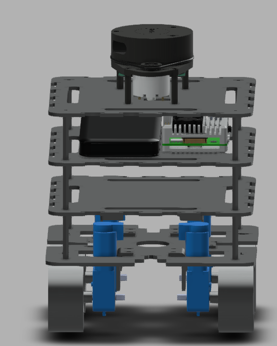
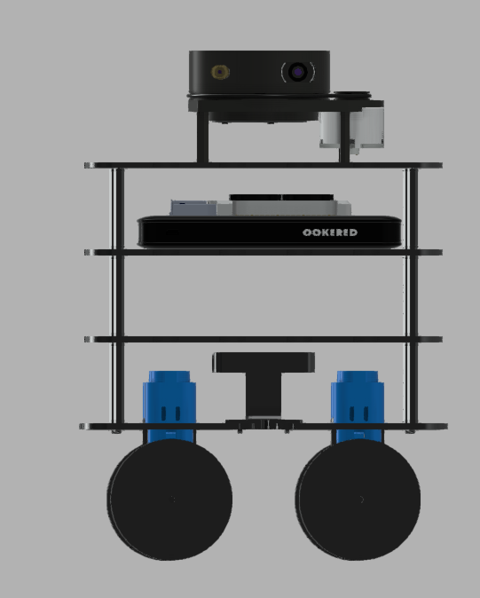
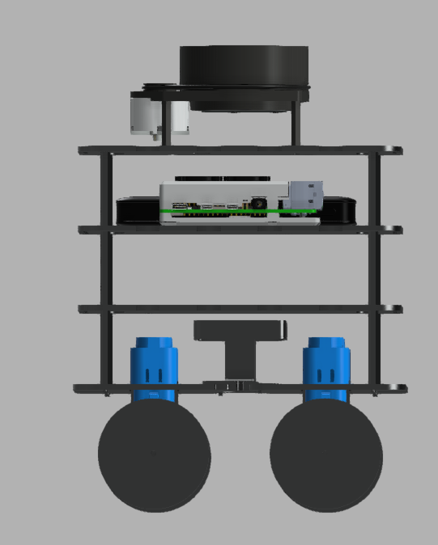
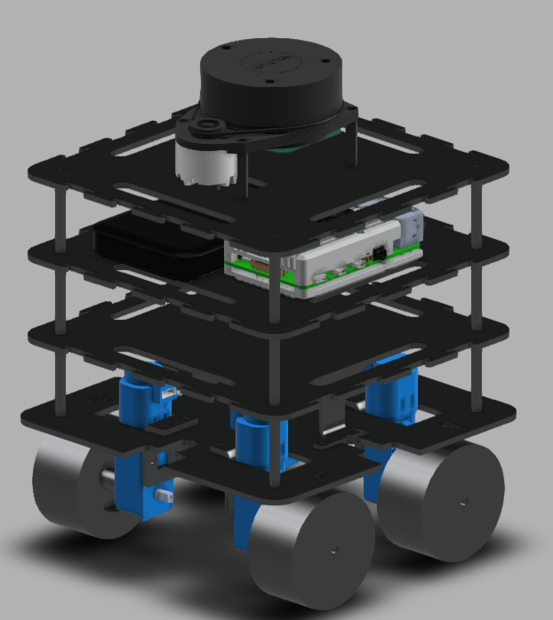

<div align="center">

<a href="https://github.com/shivamsb22/GatiBot-V2-Mecanum-AMR">

</a>

# GATIBOT V2

### Autonomous Mobile Robotics Platform

**ROS 2 | Mecanum Drive | Gazebo | SLAM | Nav2 | Embedded Systems**

*A modular autonomous mobile robot platform designed for omnidirectional movement, robot simulation, sensor integration, mapping, localization, and autonomous navigation.*

<br/>

<a href="https://docs.ros.org/en/humble/">

</a>
<a href="https://ubuntu.com/">

</a>
<a href="https://gazebosim.org/docs">

</a>
<a href="https://docs.nav2.org/">

</a>
<a href="https://github.com/SteveMacenski/slam_toolbox">

</a>

<br/>


**[Explore the Repository](https://github.com/shivamsb22/GatiBot-V2-Mecanum-AMR)**
· **[ROS 2 Documentation](https://docs.ros.org/en/humble/)**
· **[Nav2 Documentation](https://docs.nav2.org/)**

</div>

---

## 01. Project Overview

**GatiBot V2** is a robotics engineering project focused on developing a four-wheel mecanum autonomous mobile robot (AMR) using ROS 2.

Unlike conventional differential-drive robots, a mecanum platform can move laterally without first rotating its chassis. This makes it useful for navigation in constrained indoor environments, laboratory automation, research platforms, and warehouse-style material movement.

The project combines mechanical design, embedded motor control, robot modeling, simulation, sensor integration, and autonomous navigation into a modular system.

The development workflow emphasizes simulation, subsystem validation, and controlled physical testing.

### Project objectives

- Develop a mecanum-wheel mobile robot with omnidirectional movement.
- Build a structured robot description using URDF and Xacro.
- Simulate robot geometry and motion in Gazebo.
- Integrate LiDAR and other sensors into the ROS 2 ecosystem.
- Develop motor control and encoder feedback using an ESP32.
- Explore SLAM, localization, and autonomous navigation.
- Create a modular software architecture that is easier to test and maintain.

> **Development status:** In development. A feature listed in this document is not necessarily fully integrated or validated on the physical robot.


## 🧩 CAD Design Gallery

<div align="center">

**GatiBot V2 | Autodesk Fusion 360 Mechanical Design**

<p>
  
  
</p>

<p>
  
  
</p>

<sub>Four CAD perspectives showing the mechanical layout and component arrangement.</sub>

</div>

### Design highlights

- **Four-layer chassis:** Modular mounting arrangement for electronics and sensors.
- **Mecanum drive:** Four-wheel configuration designed for omnidirectional movement.
- **LiDAR mounting:** Elevated sensor position for environmental scanning.
- **Electronics integration:** Space allocated for onboard computing and motor-control hardware.
- **Mechanical visualization:** Multiple views to communicate the design more clearly.

*Images represent the CAD design. Physical dimensions, component fit, and real-world performance should be validated against the assembled robot.*

---

## 02. Design Philosophy

The system is organized into four engineering layers.

| Layer | Responsibility | Main elements |
|---|---|---|
| Mechanical | Chassis, mounting, wheel geometry | Four-layer chassis, mecanum wheels |
| Embedded | Motor actuation and low-level feedback | ESP32, motor drivers, encoders |
| Robotics software | Robot model, TF, control, perception | ROS 2, URDF, RViz2 |
| Autonomy | Mapping, localization, planning | SLAM Toolbox, Nav2, LiDAR |

The separation of responsibilities allows mechanical, embedded, simulation, and navigation components to be developed and tested independently.

---

## 03. Hardware Architecture

### 3.1 Main computing platform

| Component | Specification | Why it is used |
|---|---|---|
| Raspberry Pi 4B | 8 GB RAM | Runs the Linux-based robotics environment and ROS 2 workloads |
| MicroSD card | 64 GB | Stores the operating system, ROS packages, maps, configurations, and logs |
| ESP32-WROOM | 30-pin development board | Handles low-level motor-control and sensor-interface development |
| Raspberry Pi Camera Module 3 | Camera module | Provides a platform for future visual perception and camera-based robotics applications |

The Raspberry Pi and ESP32 serve different purposes. The Raspberry Pi runs the higher-level robotics stack, while the ESP32 is intended for time-sensitive embedded control.

The exact communication interface between them must match the implemented firmware and ROS 2 hardware interface.

### 3.2 Mecanum drive system

| Component | Quantity | Purpose |
|---|---:|---|
| 60 mm mecanum wheels | 4 | Enable omnidirectional chassis movement |
| DC geared motors with encoders | 4 | Produce wheel rotation and provide rotational feedback |
| Dual-channel motor drivers | 2 | Control motor direction and power using suitable driver electronics |
| Adjustable DC-DC converters | 2 | Provide regulated voltage rails for the intended loads |

#### Why mecanum wheels?

Mecanum wheels contain angled rollers that allow the chassis to combine the motion of four independently driven wheels.

The intended motion capabilities include:

- Forward and backward translation.
- Left and right lateral translation.
- Diagonal movement.
- Rotation about the robot's vertical axis.
- Combined translation and rotation, subject to wheel-speed limits.

Correct wheel orientation and motor ordering are critical. A wrong roller arrangement or incorrect motor mapping can cause the robot to move in an unexpected direction.

### 3.3 Chassis design

The current design concept uses a stacked, four-layer chassis.

| Parameter | Design value |
|---|---|
| Layer count | 4 |
| Nominal plate dimensions | 170 × 170 mm |
| Nominal inter-layer spacing | 40 mm |
| Bottom plate thickness | 3 mm |
| Other plate thicknesses | 2 mm |
| Wheel configuration | Four mecanum wheels |
| Mounting approach | Stacked modular platform |

These are the current design parameters, not verified manufacturing tolerances. Confirm clearances, plate stiffness, motor mounting, sensor fields of view, and the robot's center of gravity in the final CAD model.

### 3.4 LiDAR and sensors

| Sensor | Primary purpose | Integration considerations |
|---|---|---|
| RPLIDAR A1 | 2D laser scanning | Scan topic, timestamps, frame ID, scan limits |
| Raspberry Pi Camera Module 3 | Visual sensing | Camera driver, image topics, calibration |
| Ultrasonic sensors × 2 | Short-range distance measurement | Mounting direction, sensor timing, noise |
| HW-201 IR sensor | Basic infrared detection | Output logic, range, ambient-light sensitivity |
| DS18B20 | Temperature measurement | Digital bus configuration and sensor driver |
| KY-026 | Flame detection experiments | Module calibration and environmental limitations |
| LM393 sound sensor | Sound-level threshold experiments | Threshold tuning and electrical interface |
| IMU | Potential motion and orientation feedback | Sensor selection, calibration, frame alignment |

Sensor availability does not imply that every sensor is already connected to a working ROS 2 node.

The sensor topics, message types, frame IDs, update rates, and calibration parameters should be documented as the integrations are completed.

---

## 04. Power Distribution and Electrical Design

The current power concept uses a 14.8 V battery for the motor system and a separate 10,000 mAh power bank for Raspberry Pi power.

Two XL4015 adjustable step-down modules are available for the intended regulated rails:

- One converter is intended for the motor-related power rail where required by the electrical design.
- One converter is intended to provide the regulated 5 V rail for the ESP32.

The final wiring must be checked against the actual battery, motor-driver, converter, Raspberry Pi, and ESP32 specifications.

### Electrical design requirements

1. Verify the voltage and current ratings of every power component.
2. Size converters for continuous load, startup current, and thermal limits.
3. Do not route motor current through Raspberry Pi power connections.
4. Use suitable fuses, wiring, connectors, and battery protection.
5. Establish a common signal-ground reference where the interface requires it.
6. Keep motor power wiring appropriately separated from sensitive sensor signals.
7. Confirm the 5 V supply remains within the requirements of each connected device.
8. Test emergency-stop behavior before running the robot autonomously.

**Important:** A converter's advertised maximum rating is not a guarantee of its continuous output under every cooling and wiring condition. Measure the actual supply rails under load.

---

## 05. Software Stack and Official Resources

Every technology below links to its official documentation or project repository.

| Technology | Role in GatiBot V2 | Official resource |
|---|---|---|
| ROS 2 Humble | Robotics middleware, communication, nodes and tools | [Documentation](https://docs.ros.org/en/humble/) |
| Ubuntu 22.04 | Target Linux operating system | [Ubuntu](https://ubuntu.com/) |
| Gazebo | Robot simulation | [Documentation](https://gazebosim.org/docs) |
| RViz2 | Visualization of robot state, TF, maps and sensors | [ROS 2 RViz](https://github.com/ros2/rviz) |
| URDF | Robot links, joints and physical structure | [URDF tutorial](https://docs.ros.org/en/humble/Tutorials/Intermediate/URDF/URDF-Main.html) |
| Xacro | Reusable and parameterized robot descriptions | [Xacro repository](https://github.com/ros/xacro) |
| SLAM Toolbox | Mapping and SLAM | [GitHub](https://github.com/SteveMacenski/slam_toolbox) |
| Nav2 | Planning, navigation and recovery behaviors | [Documentation](https://docs.nav2.org/) |
| AMCL | Particle-filter-based localization | [ROS 2 navigation source](https://github.com/ros-navigation/navigation2) |
| ros2_control | Hardware interfaces and controller framework | [Documentation](https://control.ros.org/humble/) |
| ESP-IDF | ESP32 embedded software framework | [Documentation](https://docs.espressif.com/projects/esp-idf/en/stable/esp32/) |
| Raspberry Pi | Onboard computing hardware | [Documentation](https://www.raspberrypi.com/documentation/) |
| Git | Version control | [Documentation](https://git-scm.com/doc) |

### Version compatibility

The primary target is ROS 2 Humble on Ubuntu 22.04.

Gazebo Classic and modern Gazebo are different simulator generations. Use the simulator, plugins, controller interfaces, and ROS packages compatible with the installed environment rather than mixing launch files from incompatible versions.

---

## 06. ROS 2 Workspace Architecture

The workspace is organized around separate responsibilities.

| Package | Intended responsibility |
|---|---|
| `gati_bot_description` | URDF/Xacro, meshes, links, joints and robot visualization |
| `gati_bot_bringup` | Launch files and coordinated subsystem startup |
| `gati_bot_control` | Mecanum kinematics, velocity control and control logic |
| `gati_bot_hardware` | Interfaces to physical hardware and embedded control |
| `gati_bot_navigation` | Mapping, localization, navigation parameters and launch configuration |

The actual contents of each package should remain the source of truth.

### Conceptual system architecture

```text
                    ┌──────────────────────┐
                    │   User / Navigation   │
                    │      Goals, RViz2     │
                    └──────────┬───────────┘
                               │
                    ┌──────────▼───────────┐
                    │        Nav2          │
                    │ Planning / Recovery  │
                    └──────────┬───────────┘
                               │
                    ┌──────────▼───────────┐
                    │     SLAM / AMCL      │
                    │ Map / Localization   │
                    └──────────┬───────────┘
                               │
                    ┌──────────▼───────────┐
                    │   ROS 2 Control      │
                    │ Velocity / Feedback  │
                    └──────────┬───────────┘
                               │
                    ┌──────────▼───────────┐
                    │  Hardware Interface │
                    │   ESP32 / Encoders   │
                    └──────────┬───────────┘
                               │
                    ┌──────────▼───────────┐
                    │   Four-Motor Drive   │
                    │    Mecanum Chassis   │
                    └──────────────────────┘

     RPLIDAR ───────────────► SLAM / Localization
     Camera  ───────────────► Visual Perception
     IMU     ───────────────► State Estimation
```

This is a conceptual architecture. Actual node names, communication protocols, and controller implementations depend on the current code.

---

## 07. Mecanum Kinematics

For a four-wheel mecanum robot, the commanded chassis velocity is commonly expressed as:

- \(v_x\): forward velocity.
- \(v_y\): lateral velocity.
- \(\omega_z\): angular velocity around the vertical axis.

A common wheel-speed model is:

\[
\begin{aligned}
\omega_1 &= \frac{v_x-v_y-(L+W)\omega_z}{r}\\
\omega_2 &= \frac{v_x+v_y+(L+W)\omega_z}{r}\\
\omega_3 &= \frac{v_x+v_y-(L+W)\omega_z}{r}\\
\omega_4 &= \frac{v_x-v_y+(L+W)\omega_z}{r}
\end{aligned}
\]

Here, \(r\) is the wheel radius, while \(L\) and \(W\) represent the corresponding half-dimensions from the robot's center to the wheel locations under this convention.

The wheel numbering and signs depend on the actual wheel layout and motor orientation. This equation must be adapted and validated against the physical chassis before use.

### Control validation checklist

- Confirm wheel ordering and roller orientation.
- Verify motor direction individually.
- Test forward and backward motion.
- Test left and right strafing.
- Test clockwise and counterclockwise rotation.
- Verify encoder polarity and scaling.
- Compare commanded and measured wheel velocities.
- Validate odometry before relying on autonomous navigation.

---

## 08. Simulation and Robot Description

The URDF model defines the robot's links, joints, dimensions, inertial properties, and sensor frames.

Gazebo can then be used to evaluate the model and supported physics or sensor plugins, while RViz2 provides a visualization of robot state and ROS data.

### Recommended validation sequence

1. Check URDF/Xacro syntax.
2. Verify link and joint names.
3. Check inertial and collision geometry.
4. Inspect the TF tree.
5. Confirm the wheel joints and drive interfaces.
6. Verify sensor frames and topics.
7. Test the mecanum controller.
8. Validate odometry.
9. Proceed to mapping and navigation.

Simulation is a development and validation tool. It does not prove that the physical robot will behave identically under real friction, wheel slip, motor saturation, and sensor noise.

---

## 09. SLAM, Mapping and Navigation

### SLAM Toolbox

SLAM Toolbox is intended for constructing a map while estimating the robot's pose from supported sensor inputs.

The integration requires consistent scan data, timestamps, coordinate frames, and appropriate mapping parameters.

Official resource: [SLAM Toolbox](https://github.com/SteveMacenski/slam_toolbox)

### Localization

AMCL can estimate the robot's pose within an existing map when the required map, laser data, odometry, and transforms are configured correctly.

Official resource: [Nav2 documentation](https://docs.nav2.org/)

### Nav2

Nav2 provides a framework for goal-based navigation, planning, controller execution, and recovery behaviors.

Before testing physical navigation, verify:

- The map and localization configuration.
- The transform chain between `map`, `odom`, and `base_link`.
- The LiDAR frame and scan topic.
- Odometry direction, scale, and update rate.
- Footprint and obstacle-layer configuration.
- Velocity and acceleration limits.
- Emergency-stop and manual override behavior.

---

## 10. Terminal Installation and Build

### Requirements

- Ubuntu 22.04.
- ROS 2 Humble installed and sourced.
- Required package dependencies available.
- A workspace containing the relevant ROS 2 packages.

### Build the workspace

```bash
cd ~/gatibot_v2_ws

source /opt/ros/humble/setup.bash

# Install dependencies declared in package.xml files
rosdep install --from-paths src --ignore-src -r -y

# Build the packages
colcon build --symlink-install

# Load the workspace environment
source install/setup.bash
```

If `rosdep` is not initialized or a dependency cannot be resolved, address that issue before proceeding. These commands assume that your packages are under the `src/` directory.

### Inspect the workspace

```bash
# List ROS packages
ros2 pkg list | grep gati_bot

# Inspect running nodes
ros2 node list

# Inspect active topics
ros2 topic list

# Inspect the current transform tree
ros2 run tf2_tools view_frames
```

### Check launch files

```bash
find src -type f -path '*/launch/*' -print
```

Use the launch commands documented by the actual package files. Do not assume a launch file exists simply because a package is listed in this README.

---

## 11. Engineering and Safety

- Keep the motor power circuit within the ratings of the battery, converters, wiring, and motor drivers.
- Confirm the correct voltage before connecting the Raspberry Pi or ESP32.
- Use a suitable emergency stop and safe motor-disable behavior.
- Secure the LiDAR and camera so that their fields of view remain unobstructed.
- Validate sensor timestamps and frame IDs before running SLAM.
- Test one motor at a time during initial wiring validation.
- Keep a known-good URDF and configuration backup.
- Record calibration values and changes to controller parameters.
- Test in a clear area at low speed before enabling autonomous motion.

---

## 12. Development Roadmap

The checklist below is a development plan, not a claim that every subsystem is complete.

- [x] Create the ROS 2 workspace and package structure.
- [x] Develop the robot description.
- [x] Begin Gazebo simulation.
- [ ] Validate the complete mecanum-drive model.
- [ ] Finalize ESP32 communication and motor control.
- [ ] Validate encoder feedback and odometry.
- [ ] Integrate LiDAR and verify sensor frames.
- [ ] Validate SLAM and saved-map workflows.
- [ ] Configure AMCL and Nav2.
- [ ] Test obstacle avoidance and recovery behaviors.
- [ ] Validate the complete system on physical hardware.
- [ ] Document installation, calibration, and troubleshooting.

Update each item only after the corresponding milestone has been tested.

---

## 13. Repository Organization

The intended project organization is:

```text
gatibot_v2_ws/
├── src/
│   ├── gati_bot_description/
│   ├── gati_bot_bringup/
│   ├── gati_bot_control/
│   ├── gati_bot_hardware/
│   └── gati_bot_navigation/
├── README.md
├── gatibot_v2.urdf
├── config/
├── maps/
├── launch/
└── documentation/
```

The real repository may differ. Keep generated build directories, logs, and temporary files out of the documented source structure unless there is a specific reason to version them.

---

## 14. Official Documentation Hub

<div align="center">

<a href="https://docs.ros.org/en/humble/">

</a>
<a href="https://gazebosim.org/docs">

</a>
<a href="https://docs.nav2.org/">

</a>
<a href="https://control.ros.org/humble/">

</a>
<a href="https://docs.espressif.com/projects/esp-idf/en/stable/esp32/">

</a>

</div>

---

## 15. About the Developer

<div align="center">

### Jerry | Robotics & Automation Engineering

**Autonomous Mobile Robots · ROS 2 · SLAM · Simulation · Embedded Systems**

<a href="https://github.com/shivamsb22">

</a>

<br/><br/>


<sub>Building robotics systems through design, simulation, testing, and iteration.</sub>

</div>
